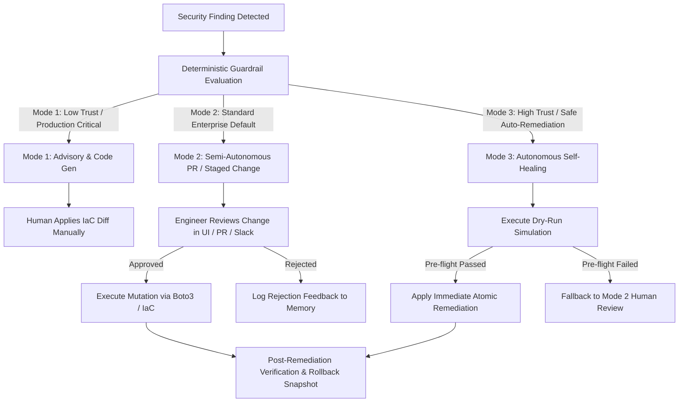

# AUTONOMOUS REMEDIATION & GOVERNANCE ARCHITECTURE
**Document ID:** `AEGIS-ARCH-013`  
**Domain:** Automated Cloud Remediation, Policy Guardrails, Rollback Runbooks, Human-in-the-Loop  
**Author:** Principal DevSecOps Engineer  
**Status:** Architecture Blueprint / Discovery Phase  

---

## 1. Executive Summary & Core Objective

The central premise of an Autonomous DevSecOps Engineer is closing the loop between detection and remediation. Identifying thousands of vulnerabilities without providing a safe, verified mechanism to fix them merely creates alert fatigue and technical debt.

However, unchecked autonomous remediation in production cloud environments is dangerous. A naive agent that closes a database security group port or revokes an IAM policy can inadvertently cause an enterprise outage.

AEGIS implements a **Progressive 3-Tier Remediation Architecture** protected by **hard deterministic policy guardrails**, **blast radius pre-validation**, and **automated dry-run and rollback runbooks**.

---

## 2. Progressive 3-Tier Remediation Model



### 2.1 Remediation Mode Definitions

| Mode | Name | Execution Model | Typical Use Cases |
| :--- | :--- | :--- | :--- |
| **Mode 1** | **Advisory & Code Generation** | Zero AWS state mutation. AEGIS generates Terraform diffs, CloudFormation templates, or AWS CLI commands. | Production core databases, VPC peering, Route 53 root zones, core IAM boundary policies. |
| **Mode 2** | **Semi-Autonomous (Default)** | AEGIS stages the fix, creates a GitHub/GitLab PR or AWS Change Set, and posts an approval prompt to Slack/UI. Mutation executes only after cryptographic sign-off. | EC2 Security Group restriction, S3 bucket encryption, IAM unused role cleanup, CloudTrail re-enablement. |
| **Mode 3** | **Fully Autonomous (Self-Healing)** | AEGIS executes immediate atomic remediation within milliseconds without waiting for human input. | Non-production environments, auto-enabling S3 Public Access Block on newly created open buckets, revoking leaked IAM access keys, quarantine of active crypto-miners. |

---

## 3. Immutable Safety Guardrails & Blast Radius Pre-Validation

Autonomous mutations are governed by strict safety rules that cannot be overridden by AI prompts:

1. **Tag-Based Exclusion Boundaries**:
   - Any resource tagged `Environment=Production`, `Tier=Critical`, or `AEGIS-Immutable=True` is **strictly prohibited from Mode 3 auto-remediation**.
   - AEGIS automatically drops Mode 3 requests on tagged resources down to Mode 2 (human sign-off required).
2. **Blast Radius Threshold**:
   - If a proposed security group modification impacts $> 3$ active compute instances, Mode 3 is aborted.
   - If an IAM policy revocation affects $> 1$ active assumed principal in the last 7 days, Mode 3 is aborted.
3. **Service Quota & Dependency Checks**:
   - Before deleting any unused security group, AEGIS performs an exhaustive ENI check across all VPCs to guarantee zero active attachments.

---

## 4. Dry-Run & Automated Rollback Runbooks

Every remediation action follows an atomic transaction pattern:

$$\text{Remediation Transaction} = \langle \text{Snapshot State} \rightarrow \text{Pre-flight Validation} \rightarrow \text{Apply Mutation} \rightarrow \text{Verify Health} \rightarrow (\text{Commit} \lor \text{Rollback}) \rangle$$

### 4.1 State Snapshot Capture
Before executing any AWS API mutation, AEGIS records the exact prior state in DynamoDB:
```json
{
  "transaction_id": "tx-88658e36-rem-042",
  "resource_arn": "arn:aws:ec2:us-east-1:123456789012:security-group/sg-0123456789abcdef0",
  "action": "RevokeSecurityGroupIngress",
  "prior_state": {
    "IpPermissions": [
      {
        "IpProtocol": "tcp",
        "FromPort": 22,
        "ToPort": 22,
        "IpRanges": [{"CidrIp": "0.0.0.0/0", "Description": "Legacy SSH"}]
      }
    ]
  },
  "timestamp": "2026-11-22T12:00:00Z",
  "status": "PENDING"
}
```

### 4.2 Automated Rollback Execution
If post-remediation health checks fail (e.g. an EC2 status check reports unhealthy, or an application endpoint returns HTTP 500 within 60 seconds), AEGIS automatically reverses the mutation:
- Re-executes Boto3 `AuthorizeSecurityGroupIngress` with the exact stored `prior_state`.
- Emits a P1 alert: *"Remediation transaction failed health check; automated rollback completed successfully."*
- Appends rollback incident details to the immutable audit ledger.
