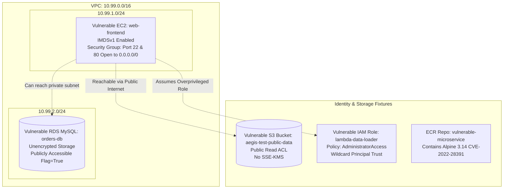

# ISOLATED DISPOSABLE AWS TEST LAB SPECIFICATION
**Document ID:** `AEGIS-ARCH-017`  
**Domain:** AWS Testing Infrastructure, Disposable Sandbox, Vulnerability Fixtures, Cost Control  
**Author:** Principal Infrastructure & Quality Engineer  
**Status:** Architecture Blueprint / Discovery Phase  

---

## 1. Executive Summary & Core Objective

To rigorously validate AEGIS’s autonomous discovery, graph attack path traversal, runtime threat correlation, and remediation capabilities against live AWS APIs without putting production workloads at risk, we require a dedicated, isolated, disposable AWS testbed.

This specification details the architecture of the **AEGIS Disposable AWS Test Lab**. It defines a deliberately vulnerable, self-contained cloud environment deployed via Terraform or CloudFormation. The test lab incorporates hard budgetary caps ($10 maximum planned budget, auto-shutdown alarm at $5), strict non-interference isolation guarantees, and an automated teardown mechanism.

---

## 2. Test Lab Vulnerability Fixture Architecture

The testbed deploys realistic, controlled security misconfigurations representing common real-world cloud attack vectors:



### 2.1 Concrete Resource Inventory
1. **Compute**:
   - 1x `t4g.nano` (or `t3.nano`) EC2 instance running Amazon Linux 2023.
   - Misconfiguration: `HttpTokens=optional` (IMDSv1 active), Security Group `0.0.0.0/0` on port 22 and port 80.
2. **Storage**:
   - 1x S3 bucket `aegis-test-lab-public-data-<account-id>`.
   - Misconfiguration: Public Read Access enabled, SSE-KMS disabled (standard SSE-S3), bucket versioning disabled.
3. **Database**:
   - 1x `db.t4g.micro` RDS MySQL single-AZ instance.
   - Misconfiguration: Storage encryption disabled, `PubliclyAccessible=true` (simulating misplaced database subnet).
4. **Identity & Access Management (IAM)**:
   - 1x IAM Role `aegis-test-overprivileged-role`.
   - Misconfiguration: Directly attaches `arn:aws:iam::aws:policy/AdministratorAccess` with trust policy allowing `*`.
5. **Container Registry**:
   - 1x Amazon ECR repository `aegis-test-workload`.
   - Misconfiguration: Tag immutability disabled, image scanning on push disabled.

---

## 3. Strict Non-Interference Guarantees

To ensure that the test lab never impacts or inspects customer production infrastructure:
1. **Mandatory Tag Isolation**:
   - Every resource in the testbed carries the tag `AEGIS-Scope=TestLab` and `AEGIS-Environment=IsolatedSandbox`.
   - When AEGIS runs in test-validation mode, its Boto3 filters strictly enforce `Tag:AEGIS-Scope == TestLab`.
2. **Network Isolation**:
   - The test VPC (`10.99.0.0/16`) has zero VPC Peering connections, zero Transit Gateway attachments, and zero Direct Connect associations.
3. **IAM Boundary Lockout**:
   - The test lab's IAM roles are constrained by an IAM Permissions Boundary that explicitly denies access to all resources outside `arn:aws:*:*:*:*/aegis-test-*`.

---

## 4. Cost Control & Automated Destruction Protocol

### 4.1 Cost Model ($10 Maximum Planning Budget)
Because the test lab uses minimal micro/nano instances and is designed to run only during verification cycles, its operational cost is negligible:
- 1x `t4g.nano` EC2: \$0.0042 / hour ($\approx \$3.02$ / month if run continuously; $\$0.05$ if run for 12 hours).
- 1x `db.t4g.micro` RDS: \$0.017 / hour ($\approx \$0.20$ for a 12-hour test run).
- 1x S3 Bucket & ECR Repo: $<\$0.01$.
- **Total Test Run Cost (4-hour validation session)**: **$<\$0.25**.

### 4.2 Automated Budgetary Circuit Breaker
```yaml
# deploy/testlab/aegis_testlab_budget.yml
Resources:
  AegisTestLabBudget:
    Type: AWS::Budgets::Budget
    Properties:
      Budget:
        BudgetName: AegisTestLabBudget
        BudgetLimit:
          Amount: 5.00
          Unit: USD
        TimeUnit: MONTHLY
        BudgetType: COST
      NotificationsWithSubscribers:
        - Notification:
            NotificationType: ACTUAL
            ComparisonOperator: GREATER_THAN
            Threshold: 80
            ThresholdType: PERCENTAGE
          Subscribers:
            - SubscriptionType: EMAIL
              Address: devsecops-alerts@company.internal
```

### 4.3 Auto-Teardown Script (`testlab_destroy.py`)
A standalone Python script executes complete cleanup via Boto3:
- Deletes S3 bucket objects and versions, followed by bucket deletion.
- Terminates RDS instance without final snapshot (`SkipFinalSnapshot=True`).
- Terminates EC2 instance and deletes Security Groups.
- Deletes IAM role and test VPC stack.
- Guarantees 100% clean account state post-test.
