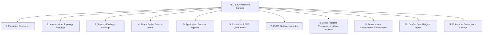

# DASHBOARD INFORMATION ARCHITECTURE & PROGRESSIVE UI STRATEGY
**Document ID:** `AEGIS-ARCH-016-REV2` (Phase 0.5 Technical Correction)  
**Domain:** Frontend Architecture, UX Progressive Evolution, Workspace Consolidation, API Mapping  
**Status:** Architecture Blueprint / Phase 0.5 Corrected  
**Changelog:** Retained and mapped all 11 existing workspaces; established progressive UI rollout matching backend workstreams; linked UI views to verified backend APIs.

---

## 1. Executive Summary & Core Objective

The AEGIS web console is the operational command center for both engineering teams and executive leadership. Converting AEGIS into a pure CLI or chatbot would destroy product value. 

This specification defines how the **existing 11 application workspaces** are retained, refined, and progressively connected to backend modules as engineering workstreams deliver capabilities.

---

## 2. The 11 Retained Workspaces & Backend API Mapping

### Complete Workspace-to-Backend Mapping:

| # | Workspace Name | URL Route | Primary Visualization & Components | Backend API Endpoint |
| :---: | :--- | :--- | :--- | :--- |
| **1** | **Executive Overview** | `/` | Posture score dial, CIS compliance dials, active P0 alerts, context freshness indicator | `GET /api/v1/overview/summary` |
| **2** | **Infrastructure Topology** | `/topology` | Dual 2D Cytoscape.js & 3D WebGL (Three.js) graph; VPC/Subnet hierarchical filtering | `GET /api/v1/topology/graph` |
| **3** | **Security Findings** | `/findings` | High-density virtualized table; CIS rule filters; finding drawer with root cause | `GET /api/v1/findings` |
| **4** | **Attack Paths** | `/attack-paths` | Directed BFS traversal graph; internet-to-crown-jewel chain; simulate patch button | `GET /api/v1/attack-paths` |
| **5** | **Application Security** | `/appsec` | SAST (Semgrep) & SCA (Grype) tree; CycloneDX SBOM dependency viewer | `GET /api/v1/appsec/summary` |
| **6** | **Containers & EKS** | `/containers` | ECR image CVE breakdown; EKS cluster posture & Pod Security Standard audit | `GET /api/v1/containers/posture` |
| **7** | **CI/CD Gatekeeper** | `/cicd` | Real-time PR evaluation stream; Terraform plan JSON diff inspector; PASS/WARN/BLOCK verdicts | `GET /api/v1/cicd/runs` |
| **8** | **Incident Response** | `/incident-response` | Chronological CloudTrail timeline; active blast radius graph; emergency containment prompt | `GET /api/v1/incidents/timeline` |
| **9** | **Remediation Center** | `/remediation` | Mode 1/2/3 queues; staged change plans; cryptographic approval buttons; rollback history | `GET /api/v1/remediations/queue` |
| **10** | **DevSecOps AI Agent** | `/agent` | Streaming Bedrock Claude 3.5 Sonnet chat; live tool trace drawer; evidence citations | `POST /api/v1/agent/chat` |
| **11** | **Settings & Governance** | `/settings` | SAML/Cognito SSO settings; RBAC user management; AWS connection health; audit ledger | `GET /api/v1/governance/audit` |

---

## 3. Incremental Frontend Evolution Strategy

To ensure engineering velocity, the frontend evolves progressively alongside backend milestones:
- **Milestone 1:** Workspaces 1, 2, 3, and 11 connected to live AWS harvesters and NetworkX graph.
- **Milestone 2:** Workspaces 5 and 6 connected to AppSec runners and ECR/EKS collectors.
- **Milestone 3:** Workspaces 7 and 8 connected to CI/CD gatekeeper CLI and EventBridge stream.
- **Milestone 4:** Workspaces 4, 9, and 10 connected to Attack Path tracer, Remediation engine, and Bedrock AgentCore.
