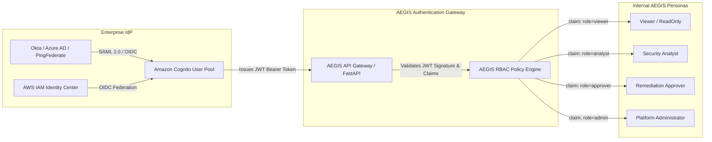

# IDENTITY, ACCESS & MULTI-TENANCY MODEL SPECIFICATION
**Document ID:** `AEGIS-ARCH-014`  
**Domain:** Identity Federation, Role-Based Access Control (RBAC), Multi-Account STS, Tenant Isolation  
**Author:** Principal Enterprise Cloud Security Architect  
**Status:** Architecture Blueprint / Discovery Phase  

---

## 1. Executive Summary & Core Objective

In an enterprise environment, security tools must themselves be zero-trust and securely partitioned. An autonomous platform capable of analyzing cloud vulnerabilities and proposing infrastructure modifications must implement rigorous authentication, fine-grained Role-Based Access Control (RBAC), and cryptographically verified audit trails.

AEGIS establishes an **Enterprise Identity & Multi-Account Access Model** designed for both single-account customer deployments and multi-account AWS Organizations. It supports enterprise Single Sign-On (SSO) via SAML 2.0 and OIDC (Okta, Azure AD, AWS IAM Identity Center), enforces 4 distinct internal RBAC personas, and leverages short-lived AWS STS AssumeRole delegation for multi-account infrastructure harvesting.

---

## 2. Authentication & Enterprise Identity Federation



### 2.1 Token Validation & Scope Verification
- Every incoming HTTP request must include an `Authorization: Bearer <JWT>` header issued by the customer's Amazon Cognito User Pool.
- The FastAPI middleware (`backend/api/auth.py`) cryptographically validates the token against Cognito's JSON Web Key Set (JWKS), verifying signature, expiration (`exp`), issuer (`iss`), and required customer tenant ID.

---

## 3. Fine-Grained Role-Based Access Control (RBAC) Matrix

| Persona | View Posture & Topology | Run Scans & Bedrock Queries | Approve Mode 2 Remediations | Configure Mode 3 Self-Healing | Manage Cloud Accounts & API Keys |
| :--- | :---: | :---: | :---: | :---: | :---: |
| **Viewer** | ✅ Read-Only | ❌ Prohibited | ❌ Prohibited | ❌ Prohibited | ❌ Prohibited |
| **Security Analyst** | ✅ Read-Only | ✅ Full Access | ❌ Prohibited | ❌ Prohibited | ❌ Prohibited |
| **Remediation Approver** | ✅ Read-Only | ✅ Full Access | ✅ Cryptographic Approval | ❌ Prohibited | ❌ Prohibited |
| **Platform Administrator** | ✅ Full Access | ✅ Full Access | ✅ Cryptographic Approval | ✅ Full Configuration | ✅ Full Management |

---

## 4. Multi-Account Harvesting Architecture (AWS Organizations)

For enterprises operating dozens or hundreds of AWS accounts under AWS Organizations, AEGIS employs a **Hub-and-Spoke STS AssumeRole Architecture**.

```mermaid
flowchart TD
    subgraph Hub Account (Security Tooling / 111111111111)
        AEGIS[AEGIS In-Account Deployment]
        HubRole[aegis-hub-orchestrator-role]
    end

    subgraph Spoke Account 1 (Production Workloads / 222222222222)
        SpokeRole1[aegis-cross-account-auditor-role]
        Workloads1[(Prod EKS, RDS, S3)]
    end

    subgraph Spoke Account 2 (Staging Workloads / 333333333333)
        SpokeRole2[aegis-cross-account-auditor-role]
        Workloads2[(Staging EC2, VPC, ECR)]
    end

    AEGIS --> HubRole
    HubRole -->|sts:AssumeRole with ExternalId| SpokeRole1
    HubRole -->|sts:AssumeRole with ExternalId| SpokeRole2
    SpokeRole1 --> Workloads1
    SpokeRole2 --> Workloads2
```

### 4.1 Cross-Account IAM Security Best Practices
1. **ExternalId Requirement**: To prevent the confused deputy problem, every cross-account AssumeRole call requires a customer-configured cryptographic `ExternalId`.
2. **Short Session Durations**: STS sessions are requested with a maximum lifetime of 900 seconds (15 minutes).
3. **Scoped Trust Policies**: The spoke account IAM role trust policy restricts access strictly to the Hub account's orchestrator role ARN:
```json
{
  "Version": "2012-10-17",
  "Statement": [
    {
      "Effect": "Allow",
      "Principal": {
        "AWS": "arn:aws:iam::111111111111:role/aegis-hub-orchestrator-role"
      },
      "Action": "sts:AssumeRole",
      "Condition": {
        "StringEquals": {
          "sts:ExternalId": "c8a4f910-b452-4e3a-92a1-e374bb9f8a20"
        }
      }
    }
  ]
}
```

---

## 5. Machine-to-Machine (M2M) API Token Management

For CI/CD pipelines (GitHub Actions, GitLab CI) and SIEM integrations, AEGIS issues scoped M2M API keys:
- Keys are prefixed with `aegis_live_` followed by 32 cryptographically random alphanumeric characters.
- In the AEGIS database, keys are **never stored in plaintext**; only their `SHA-256` digest is stored.
- Each key is assigned a strict scope (e.g. `cicd:scan_only`), an expiration date, and IP CIDR allowlist restrictions.
