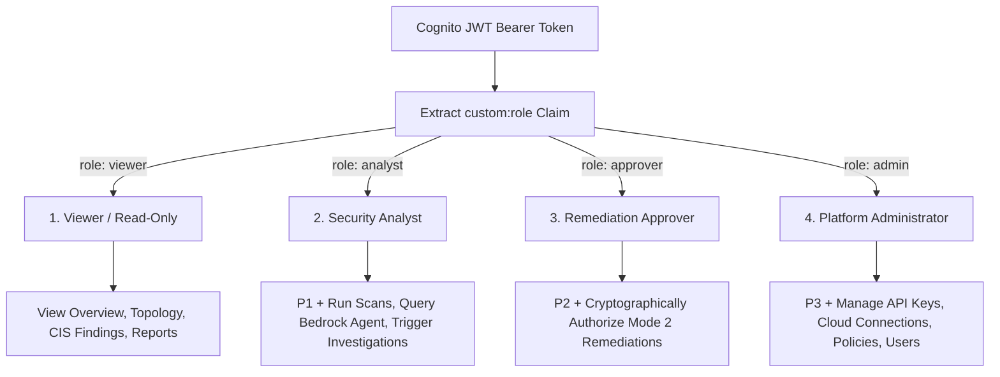

# IDENTITY, ACCESS & GOVERNANCE MODEL SPECIFICATION
**Document ID:** `AEGIS-ARCH-014-REV2` (Phase 0.5 Technical Correction)  
**Domain:** Identity Federation, AWS IAM Identity Center, Cognito, RBAC, Single-Account Simplicity  
**Status:** Architecture Blueprint / Phase 0.5 Corrected  
**Changelog:** Prioritized effortless single-account onboarding; evaluated AWS IAM Identity Center vs Amazon Cognito; established separation of duties across 4 enterprise RBAC personas.

---

## 1. Executive Summary & Core Objective

Enterprise identity must balance security with operational simplicity. For an initial deployment, customer onboarding must be effortless—requiring zero complex cross-account configurations. As the organization expands, the platform must seamlessly federate with corporate identity providers (IdPs).

This specification details the **Enterprise Identity & Access Architecture**, comparing AWS IAM Identity Center with Amazon Cognito, and enforcing strict separation of duties across 4 RBAC roles.

---

## 2. Customer Identity Federation: Cognito vs AWS IAM Identity Center

| Dimension | Amazon Cognito User Pools | AWS IAM Identity Center (Formerly AWS SSO) | AEGIS Strategy |
| :--- | :--- | :--- | :--- |
| **Target Audience** | Web application users, external partners, customer engineers | Enterprise employees, AWS administrators, internal DevOps | **Hybrid Federation Supported** |
| **SAML 2.0 / OIDC** | Supports Okta, Azure AD, Google Workspace, PingFederate | Native integration with corporate Active Directory / Okta | **Cognito Default / IAM Identity Center Opt-In** |
| **Single-Account Onboarding** | Provisions automatically in CloudFormation with zero external setup | Requires AWS Organizations and management account enablement | **Cognito Default for Zero-Friction Setup** |
| **M2M API Authentication** | Native OAuth2 client credentials grant | Requires IAM roles / STS federation | **Cognito for CI/CD API Keys** |

### Initial Release Recommendation:
AEGIS deploys an **Amazon Cognito User Pool** by default inside the CloudFormation stack. Customers can log in using local credentials or connect their corporate SAML/OIDC provider (Okta/Azure AD) in under 10 minutes.

---

## 3. Role-Based Access Control (RBAC) & Separation of Duties

AEGIS enforces 4 distinct enterprise personas via JWT claim inspection:

### Permission Enforcement Rules:
- **Separation of Duties:** A user holding the `Security Analyst` role can *generate* a remediation change plan, but **cannot approve it**. Approval strictly requires the `Remediation Approver` role.
- **Audit Ledger:** Every role transition, scan execution, and remediation approval is recorded in the immutable audit log with user identity, timestamp, and client IP.
