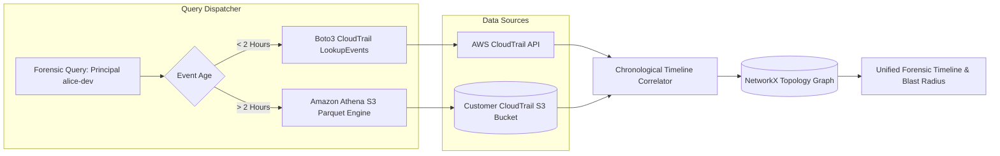

# INCIDENT RESPONSE & FORENSIC INVESTIGATION ARCHITECTURE
**Document ID:** `AEGIS-ARCH-012-REV2` (Phase 0.5 Technical Correction)  
**Domain:** Cloud Forensics, CloudTrail Correlation, Blast Radius, S3 Object Lock Semantics  
**Status:** Architecture Blueprint / Phase 0.5 Corrected  
**Changelog:** Corrected S3 Object Lock design; replaced forced Compliance Mode with Governance Mode default; added Legal Hold option; detailed CloudTrail Athena query partitioning to eliminate Boto3 API throttling.

---

## 1. Executive Summary & Core Objective

During an active cloud security incident, security teams face fragmented log telemetry, slow manual investigations, and severe API rate limits when querying AWS CloudTrail. 

AEGIS provides an **Autonomous Forensic Investigation Engine** that correlates CloudTrail management events, GuardDuty alerts, and graph state to reconstruct chronological attack timelines, calculate active blast radius, and generate verified containment plans.

---

## 2. Evidence Archival & S3 Object Lock Semantics

### 2.1 The Critical Distinction: Governance Mode vs Compliance Mode

| Feature | S3 Object Lock Governance Mode (Recommended Default) | S3 Object Lock Compliance Mode (Strict Enterprise Audit) |
| :--- | :--- | :--- |
| **Root User Deletion** | **Permitted** (With `s3:BypassGovernanceRetention` permission). | **Strictly Prohibited** (Even AWS Account Root cannot delete or shorten retention). |
| **Accidental Cost Risk** | Low (Retention can be adjusted if massive unintended logs are stored). | **Extremely High** (Customer must pay for storage until retention expires; irreversible). |
| **Retention Duration** | 30 to 90 days (Customer configurable). | 365 to 2555 days (Strict regulatory only). |
| **AEGIS Recommendation** | **Adopt as Platform Default.** | **Opt-In Only** (Requires CISO / Founder explicit sign-off). |

### 2.2 S3 Legal Hold
For active investigations, AEGIS applies an **S3 Legal Hold** (`s3:PutObjectLegalHold`). Unlike timed retention periods, a Legal Hold prevents object deletion indefinitely until explicitly removed by a security investigator, providing flexible evidence preservation without permanent storage lock-in.

---

## 3. High-Performance Forensic Query Architecture

### 3.1 Overcoming CloudTrail API Throttling
AWS CloudTrail `LookupEvents` enforces a hard rate limit of **2 requests per second per account**. Issuing repeated queries during an incident causes immediate HTTP 429 throttling.

### AEGIS 2-Tier Forensic Query Engine:
1. **Recent Live Events ($< 2$ hours):** Boto3 `LookupEvents` with client-side exponential backoff, jitter, and strict attribute filters (`Username`, `EventName`, `ResourceName`).
2. **Historical Forensics ($> 2$ hours):** Queries the customer's CloudTrail S3 bucket directly using **Amazon Athena partition projection** (or local DuckDB parquet scanning for small scopes). This bypasses AWS CloudTrail API limits entirely and scans gigabytes of audit logs in seconds.

---

## 4. Blast Radius Computation & Containment Playbooks

Given a compromised entity $V_{\text{target}}$:
$$\text{BlastRadius}(V_{\text{target}}) = \{ u \in V \mid \exists \text{ path } P = (V_{\text{target}}, \dots, u) \}$$

### Containment Playbooks (Requiring Mode 2 Human Approval):
1. **IAM Credential Invalidation:** Deactivates compromised access keys (`UpdateAccessKey: Status=Inactive`) and attaches a temporary inline deny policy terminating active sessions.
2. **EC2 Quarantine:** Detaches public IP / EIP and attaches an isolated quarantine security group blocking all ingress/egress.
3. **S3 Bucket Lockdown:** Attaches emergency bucket policy denying public and external account access.
