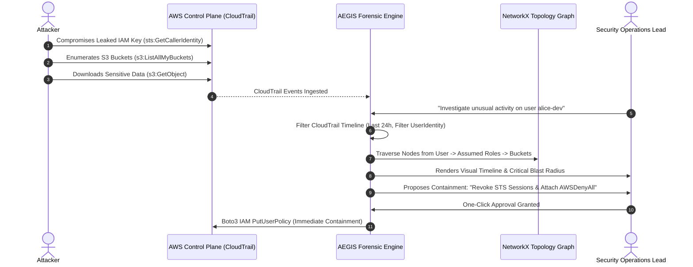

# INCIDENT RESPONSE & FORENSIC INVESTIGATION ARCHITECTURE
**Document ID:** `AEGIS-ARCH-012`  
**Domain:** Cloud Incident Response, CloudTrail Forensics, Blast Radius, Automated Containment  
**Author:** Principal Enterprise Cloud Security Architect  
**Status:** Architecture Blueprint / Discovery Phase  

---

## 1. Executive Summary & Core Objective

When an active security incident occurs in AWS, traditional incident response is crippled by fragmented telemetry, slow manual log queries across terabytes of CloudTrail logs, and delays in calculating what resources an attacker has accessed or could access next.

AEGIS transforms incident response into an **autonomous, graph-augmented investigation workflow**. When an alert fires (or when a human operator asks *"Investigate recent suspicious activity on role X"*), AEGIS:
1. Reconstructs the exact chronological forensic timeline from AWS CloudTrail and GuardDuty.
2. Performs automated blast radius calculation by traversing the infrastructure graph outward from the compromised identity or resource.
3. Synthesizes a natural language Incident Briefing with verifiable indicators of compromise (IOCs).
4. Generates an emergency Containment Action Plan (e.g. session revocation, policy quarantine, security group isolation) requiring one-click human approval.
5. Archives an immutable, cryptographically verifiable evidence bundle to Amazon S3 with Object Lock.

---

## 2. Forensic Timeline Reconstruction Engine

### 2.1 Multi-Source Chronological Correlation
AEGIS correlates three distinct telemetry layers:
- **Control Plane Events**: AWS CloudTrail management events (`LookupEvents` / Athena queries against CloudTrail S3 bucket).
- **Data Plane Events**: S3 object access, KMS decrypt operations, DynamoDB read bursts.
- **Network & Threat Telemetry**: GuardDuty findings, VPC Flow Log anomalies, Route 53 DNS exfiltration queries.



### 2.2 Forensic Query Optimization
To avoid AWS CloudTrail `LookupEvents` rate limiting (2 API calls per second per account), AEGIS implements a two-tier strategy:
1. **Recent Events ($< 2$ hours)**: Boto3 `cloudtrail:LookupEvents` with client-side exponential backoff and attribute filters (`EventName`, `Username`, `ResourceName`).
2. **Historical Forensics ($> 2$ hours)**: Queries the customer's CloudTrail S3 bucket using Amazon Athena partition projection or local DuckDB parquet scanning, eliminating API throttling entirely.

---

## 3. Blast Radius Computation Algorithm

Given a compromised entity $V_{\text{target}}$ (e.g. an EC2 instance, IAM role, or EKS pod), the Blast Radius is computed via directional graph traversal on the directed multigraph $G = (V, E)$:

$$\text{BlastRadius}(V_{\text{target}}) = \left\{ u \in V \mid \exists \text{ path } P = (V_{\text{target}}, \dots, u) \text{ where } \forall e \in P, \text{privilege}(e) > 0 \right\}$$

### Classification of Impacted Nodes:
1. **Tier 1 (Direct Control)**: Resources the entity can directly modify or delete (e.g. KMS keys, DynamoDB tables, VPC route tables).
2. **Tier 2 (Lateral Movement Opportunities)**: EC2 instances the role can SSM into, or IAM roles it can assume via `sts:AssumeRole`.
3. **Tier 3 (Crown Jewels at Risk)**: S3 buckets containing customer PII/financial records, production RDS clusters, or Route 53 public DNS zones reachable along the directed path.

---

## 4. Automated Containment Standard Operating Procedures (SOPs)

AEGIS prepares instant, deterministic containment actions tailored to the compromise type:

### SOP 1: IAM Credential Invalidation
- **Action**: Immediately attaches an explicit deny inline policy and revokes all active STS sessions.
```json
{
  "Version": "2012-10-17",
  "Statement": [
    {
      "Sid": "AegisEmergencyRevoke",
      "Effect": "Deny",
      "Action": "*",
      "Resource": "*",
      "Condition": {
        "DateLessThan": {
          "aws:TokenIssueTime": "2026-11-22T12:00:00Z"
        }
      }
    }
  ]
}
```

### SOP 2: EC2 Host Isolation
- **Action**: Modifies instance network interface (ENI) security groups, replacing them with a dedicated quarantine security group (`aegis-quarantine-sg`) that blocks all ingress and egress traffic except to the forensic analysis workstation.
- **Snapshot Creation**: Triggers Boto3 `ec2:CreateSnapshot` on all attached EBS volumes for offline disk forensics.

### SOP 3: S3 Bucket Quarantine
- **Action**: Applies emergency bucket policy denying all `s3:GetObject` and `s3:PutObject` operations except for designated incident response role ARN.

---

## 5. Post-Incident Evidence Archival & Chain of Custody

All investigative artifacts are bundled into a tamper-evident forensic package:
- Complete JSON dump of relevant CloudTrail log records.
- Graph sub-tree snapshot at the moment of compromise.
- Bedrock AI reasoning chain and verification verdicts.
- Cryptographic SHA-256 hash generated and stored in an immutable Amazon S3 bucket with **Object Lock (Compliance Mode)** enabled for 365 days.
