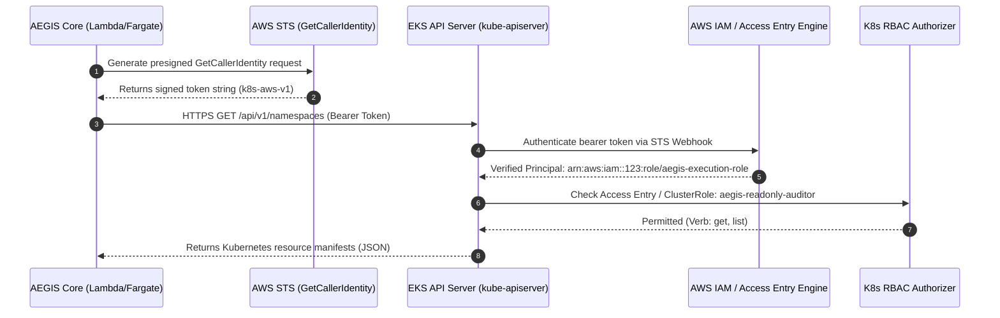

# KUBERNETES & EKS SECURITY ARCHITECTURE SPECIFICATION
**Document ID:** `AEGIS-ARCH-009-REV2` (Phase 0.5 Technical Correction)  
**Domain:** Amazon EKS, Kubernetes Security Posture Management (KSPM), EKS Access Entries, Kubernetes RBAC  
**Status:** Architecture Blueprint / Phase 0.5 Corrected  
**Changelog:** Corrected authentication architecture; replaced IRSA misuse with AWS EKS Access Entries & IAM Authenticator tokens; added network topology requirements (private vs public API endpoints); defined scoped read-only ClusterRole and customer setup prerequisites.

---

## 1. Executive Summary & Core Objective

Amazon Elastic Kubernetes Service (EKS) represents a primary compute tier for enterprise container workloads. However, Kubernetes introduces a layered attack surface bridging container images, Kubernetes RBAC, API server access controls, and AWS IAM cloud credentials.

This specification defines how a customer-deployed AEGIS instance discovers, connects to, and inspects existing customer Amazon EKS clusters without intrusive host agents, mutating webhooks, or permanent cluster administrative credentials.

---

## 2. EKS Authentication & Authorization Architecture

### 2.1 Technical Clarification: IRSA vs EKS Cluster Ingress Authentication
- **What IRSA Actually Is:** IAM Roles for Service Accounts (IRSA) is an in-cluster mechanism whereby Kubernetes Pods obtain temporary AWS IAM credentials via OIDC federation with AWS STS (`sts:AssumeRoleWithWebIdentity`). 
- **What AEGIS Requires:** AEGIS is an external service (or Lambda/Fargate task in the customer's account) that needs to authenticate *into* the customer's Kubernetes API server.
- **The Correct EKS Ingress Architecture:**
  1. **EKS Access Entries (Modern Standard - EKS 1.23+):** The customer provisions an EKS Access Entry linking the AEGIS execution IAM Role ARN (`arn:aws:iam::123456789012:role/aegis-core-execution-role`) with the AWS-managed `AmazonEKSViewPolicy` or `AmazonEKSClusterAdminPolicy` with scoped access.
  2. **Legacy `aws-auth` ConfigMap (Fallback for older clusters):** Maps the AEGIS IAM Role ARN to a Kubernetes RBAC group (`aegis-auditors`).
  3. **STS Token Generation:** AEGIS uses `botocore.signers.RequestSigner` to generate a presigned AWS STS `GetCallerIdentity` URL, base64-encoded as a bearer token (`k8s-aws-v1.<token>`).
  4. **Kubernetes RBAC Authorization:** The Kubernetes API server validates the STS bearer token against AWS IAM, maps the IAM principal to an identity, and enforces the attached read-only `ClusterRole`.



---

## 3. Network Topology & API Endpoint Reachability

Customer EKS clusters employ three endpoint access configurations:
1. **Public Endpoint Only:** AEGIS connects directly over TLS 1.3 via the public FQDN.
2. **Public and Private Endpoints:** External traffic routes via public IP, internal traffic routes via VPC. AEGIS connects over HTTPS.
3. **Private Endpoint Only (Enterprise Standard):** The Kubernetes API server has no public DNS or IP; it is accessible only from within the cluster's VPC or peered networks.

### AEGIS Network Prerequisites for Private Clusters:
- **VPC Subnet Placement:** The AEGIS Lambda backend or Fargate task must be attached to the customer's VPC (or a peered VPC) with subnets that have route table connectivity to the EKS cluster's VPC subnets.
- **Security Group Ingress:** The EKS Cluster Security Group must allow inbound TCP port 443 from the AEGIS security group (`aegis-backend-sg`).
- **Private DNS Resolution:** Core VPC DHCP options must resolve the cluster's private Amazon Route 53 resolver endpoint.

---

## 4. Scoped Kubernetes RBAC Specification

AEGIS requires strictly read-only inspection capabilities. The customer applies this manifest during cluster onboarding:

```yaml
# deploy/k8s/aegis_readonly_clusterrole.yaml
apiVersion: rbac.authorization.k8s.io/v1
kind: ClusterRole
metadata:
  name: aegis-readonly-auditor
  labels:
    app.kubernetes.io/name: aegis
    app.kubernetes.io/part-of: devsecops
rules:
  # Core Workloads & Nodes
  - apiGroups: [""]
    resources: ["pods", "nodes", "namespaces", "services", "serviceaccounts", "configmaps", "endpoints"]
    verbs: ["get", "list"]
  # Deployments, DaemonSets, StatefulSets
  - apiGroups: ["apps"]
    resources: ["deployments", "daemonsets", "statefulsets", "replicasets"]
    verbs: ["get", "list"]
  # Batch Workloads
  - apiGroups: ["batch"]
    resources: ["jobs", "cronjobs"]
    verbs: ["get", "list"]
  # RBAC Inspection (Evaluating privilege escalation)
  - apiGroups: ["rbac.authorization.k8s.io"]
    resources: ["clusterroles", "clusterrolebindings", "roles", "rolebindings"]
    verbs: ["get", "list"]
  # Pod Security & Disruption
  - apiGroups: ["policy"]
    resources: ["poddisruptionbudgets"]
    verbs: ["get", "list"]
  # Ingress & Network Policies
  - apiGroups: ["networking.k8s.io"]
    resources: ["networkpolicies", "ingresses"]
    verbs: ["get", "list"]
---
apiVersion: rbac.authorization.k8s.io/v1
kind: ClusterRoleBinding
metadata:
  name: aegis-readonly-auditor-binding
subjects:
  - kind: Group
    name: aegis-auditors
    apiGroup: rbac.authorization.k8s.io
roleRef:
  kind: ClusterRole
  name: aegis-readonly-auditor
  apiGroup: rbac.authorization.k8s.io
```

> [!IMPORTANT]
> Secrets (`apiGroups: [""], resources: ["secrets"]`) are **explicitly excluded** from the `ClusterRole`. AEGIS inspects workload configurations and service account permissions without ever reading raw Kubernetes secrets or environment variable secret values.

---

## 5. Kubernetes Posture Auditing Scope

AEGIS audits EKS clusters across 4 operational domains:
1. **Pod Security Standards (PSS):** Validates all workloads against `Privileged`, `Baseline`, and `Restricted` standards (e.g., flagging `privileged: true`, `hostPID: true`, `runAsRoot: true`, missing resource limits).
2. **RBAC Least Privilege:** Identifies wildcard permissions (`*`), secret-stealing cluster roles, and default service account token auto-mounting.
3. **Control Plane Configuration:** Boto3 `eks:DescribeCluster` audits cluster logging status (API, Audit, Authenticator, ControllerManager, Scheduler) and control plane version deprecation.
4. **Hybrid EKS-to-AWS Lateral Attack Paths:**
   - Detects Pods mounting ServiceAccounts annotated with `eks.amazonaws.com/role-arn` (IRSA) that grant sensitive AWS data access.
   - Detects EC2 worker nodes lacking IMDSv2 (`HttpPutResponseHopLimit > 1`), allowing container root escapes to steal node instance profile credentials.
