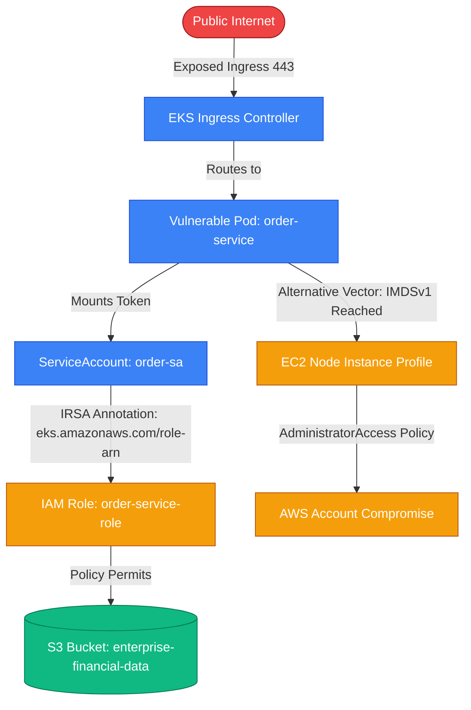

# KUBERNETES & EKS SECURITY ARCHITECTURE SPECIFICATION
**Document ID:** `AEGIS-ARCH-009`  
**Domain:** Container Orchestration, Amazon EKS, Kubernetes Security Posture Management (KSPM)  
**Author:** Principal Enterprise Cloud Security Architect  
**Status:** Architecture Blueprint / Discovery Phase  

---

## 1. Executive Summary & Core Objective

Amazon Elastic Kubernetes Service (EKS) represents the primary runtime workload execution platform for modern cloud-native enterprises. However, Kubernetes introduces a multi-layered attack surface that bridges container vulnerabilities, Kubernetes API misconfigurations, overly permissive Role-Based Access Control (RBAC), Pod Security Standard (PSS) violations, and underlying AWS cloud infrastructure.

AEGIS extends its autonomous DevSecOps intelligence into Amazon EKS with an **agentless-first, non-intrusive discovery model** combined with **ephemeral in-cluster auditing**. AEGIS discovers EKS clusters, node groups, and Fargate profiles via AWS Boto3 APIs, connects securely to the Kubernetes API server using AWS IAM Authenticator and OIDC federation (IRSA), inspects cluster state, detects privilege escalation vectors, and traces hybrid attack paths bridging Kubernetes pods to AWS Cloud IAM credentials.

---

## 2. EKS Discovery & Kubernetes API Access Strategy

### 2.1 AWS Control Plane Discovery (Agentless AWS Tier)
The AEGIS AWS collector discovers EKS clusters and managed infrastructure through the following standard read-only Boto3 operations:
- `eks:ListClusters` & `eks:DescribeCluster` (API server endpoint, certificate authority, OIDC issuer URL, logging status, cluster version, VPC config).
- `eks:ListNodegroups` & `eks:DescribeNodegroup` (Instance types, AMI version, IAM node instance role, security groups, subnets).
- `eks:ListFargateProfiles` & `eks:DescribeFargateProfile` (Pod execution roles, selectors).
- `eks:ListAddons` & `eks:DescribeAddon` (VPC-CNI, CoreDNS, Kube-Proxy, GuardDuty agent versions).

### 2.2 Kubernetes Control Plane Authentication (IRSA / IAM Authenticator)
AEGIS does not store static `kubeconfig` files or long-lived service account tokens. Authentication follows modern AWS IAM best practices:
1. **IAM Role for Service Accounts (IRSA)**: The AEGIS orchestrator assumes an IAM role (`aegis-k8s-auditor-role`) that is mapped inside the target EKS cluster's `aws-auth` ConfigMap or modern EKS Access Entries (`eks:CreateAccessEntry`).
2. **Ephemeral Bearer Token Generation**: Using `botocore.signers.RequestSigner`, AEGIS generates a short-lived (15-minute) signed AWS STS `GetCallerIdentity` token matching the `k8s-aws-v1` format.
3. **Restricted ClusterRole**: AEGIS binds strictly to a read-only `ClusterRole` granting `get`, `list`, and `watch` permissions across core, apps, batch, and rbac.authorization.k8s.io API groups.

```yaml
# deploy/k8s/aegis_readonly_clusterrole.yaml
apiVersion: rbac.authorization.k8s.io/v1
kind: ClusterRole
metadata:
  name: aegis-readonly-auditor
  labels:
    app.kubernetes.io/name: aegis
rules:
  - apiGroups: [""]
    resources: ["pods", "nodes", "namespaces", "services", "serviceaccounts", "configmaps"]
    verbs: ["get", "list"]
  - apiGroups: ["apps"]
    resources: ["deployments", "daemonsets", "statefulsets", "replicasets"]
    verbs: ["get", "list"]
  - apiGroups: ["batch"]
    resources: ["jobs", "cronjobs"]
    verbs: ["get", "list"]
  - apiGroups: ["rbac.authorization.k8s.io"]
    resources: ["clusterroles", "clusterrolebindings", "roles", "rolebindings"]
    verbs: ["get", "list"]
  - apiGroups: ["policy"]
    resources: ["poddisruptionbudgets"]
    verbs: ["get", "list"]
```

---

## 3. Kubernetes Security Posture Management (KSPM) Engine

AEGIS evaluates cluster security across four critical vectors:

### 3.1 Pod Security Standards (PSS) & Workload Security
Evaluates every workload against the Kubernetes Pod Security Standards (Baseline and Restricted):
- **Privileged Containers**: Detects `securityContext.privileged: true` allowing full root breakout to the host kernel.
- **Host Namespace Sharing**: Detects `hostPID: true`, `hostNetwork: true`, or `hostIPC: true`.
- **Root Execution**: Identifies containers running with `runAsNonRoot: false` or `runAsUser: 0`.
- **Capability Additions**: Detects dangerous Linux capabilities like `SYS_ADMIN`, `NET_ADMIN`, `SYS_PTRACE`, `DAC_OVERRIDE`.
- **Writable Root Filesystem**: Flags absence of `readOnlyRootFilesystem: true`.
- **Resource Constraints**: Audits missing CPU/memory requests and limits preventing Node DoS.

### 3.2 RBAC Least-Privilege & Escalation Analysis
Audits Kubernetes RBAC configurations to find dangerous permissions:
- **Wildcard Permissions**: Detects `*` in verbs or resources.
- **Privilege Escalation Roles**: Flags roles permitting `bind` or `escalate` on ClusterRoles.
- **Secret Theft Vectors**: Flags workloads allowed to `get` or `list` secrets in sensitive namespaces (`kube-system`, `aegis`).
- **Cluster Admin Overuse**: Maps all subjects bound to `cluster-admin`.
- **AutomountServiceAccountToken**: Detects default service account tokens automatically mounted into pods where API access is unnecessary.

### 3.3 Node Security & CIS Kubernetes Benchmark
- **Kubelet Configuration**: Evaluates anonymous authentication, webhook auth, and read-only port exposure (`10255`).
- **Node IAM Instance Profiles**: Verifies whether worker nodes utilize IMDSv2 with hop count 1 to prevent pods from stealing EC2 node instance credentials.
- **Container Runtime**: Verifies containerd configuration and rootless execution where applicable.

---

## 4. Attack Path Bridging: Hybrid K8s-to-AWS Lateral Movement

The most severe cloud vulnerabilities occur at the seam between Kubernetes and AWS IAM. AEGIS's unified NetworkX graph links Kubernetes workloads directly to AWS IAM identities.



### 4.1 Hybrid Attack Path Detection Rules
1. **IRSA Blast Radius**: A pod with RCE vulnerability or public exposure has an associated IRSA role granting write/delete permissions to sensitive AWS data.
2. **IMDSv1 Node Steal**: A pod running on an EC2 worker node lacking `HttpEndpoint=enabled` and `HttpPutResponseHopLimit=1` can query `169.254.169.254` and retrieve temporary node instance credentials.
3. **EKS Access Entry Overprivilege**: An IAM role mapped with `AmazonEKSClusterAdminPolicy` without MFA or IP restriction.

---

## 5. Tool Evaluation & Selection Matrix

| Tool | Focus | Performance | Integration Strategy | AEGIS Recommendation |
| :--- | :--- | :--- | :--- | :--- |
| **Boto3 EKS Client** | AWS Control Plane | Real-time / Immediate | Native Python | **Adopted (Core Engine)** |
| **K8s Python Client** | K8s API Inspection | Fast (<5s per cluster) | Embedded in AEGIS backend | **Adopted (API Auditor)** |
| **Kubescape (ARMO)** | CIS Benchmark & NSA-CISA | Moderate | Subprocess / Container Job | **Phase 1 Optional Runner** |
| **Trivy Operator** | In-Cluster Image & Vuln | High memory footprint | In-cluster DaemonSet | **Avoided (Too invasive)** |
| **kube-bench** | CIS Worker Node Benchmark | Ephemeral Job | Ephemeral Kubernetes Job | **Adopted for Deep Scan** |

---

## 6. Enterprise Safety & Customer Impact

1. **Zero Workload Interference**: AEGIS does not inject mutating admission webhooks, proxies, or resident agents into customer clusters.
2. **Zero Ingress/Egress Tampering**: AEGIS never alters Service, Ingress, or NetworkPolicy definitions without explicit Mode 2/3 remediation approval.
3. **Bandwidth & CPU Guarantees**: Kubernetes API requests are throttled with a client-side token bucket (`qps=10`, `burst=20`) to prevent API server saturation during discovery.
