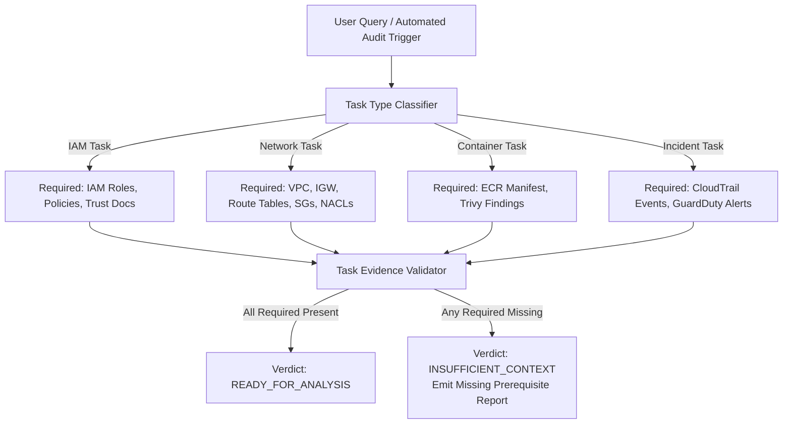

# PHASE 0.5 ARCHITECTURE REVIEW & TECHNICAL AUDIT REPORT
**Document ID:** `AEGIS-ARCH-025`  
**Domain:** Architecture Review, Technical Corrections, Security Weakness Resolution, Engineering Readiness  
**Status:** Complete & Authoritative  

---

## 1. Executive Summary

Phase 0.5 provides a rigorous architectural audit and correction of the 23 specifications produced during Phase 0. 

All identified technical inaccuracies, unsafe remediation assumptions, licensing ambiguities, and workstream sequencing flaws have been forensically investigated and resolved. The architecture is now internally consistent, mathematically sound, legally verified, and aligned with official AWS well-architected principles.

---

## 2. Audit of the 7 Critical Technical Issues (A through G)

### ISSUE A: Kubernetes Authentication & Authorization (EKS)
- **Previous Flaw:** Misused IRSA terminology as an external authentication method for AEGIS into EKS.
- **Correction Applied:** Documented modern **AWS EKS Access Entries** (`eks:CreateAccessEntry`, `eks:AssociateAccessPolicy`) with `AmazonEKSViewPolicy` or scoped `ClusterRoleBinding` to the AEGIS execution role. Presigned STS `GetCallerIdentity` bearer tokens (`k8s-aws-v1`) provide external API server access. Specified VPC subnet placement and security group ingress requirements for private clusters.
- **Status:** **Resolved in [`KUBERNETES_SECURITY_DESIGN.md`](file:///c:/Users/mindo/Documents/Builder%20Center/aegis/docs/next_phase/KUBERNETES_SECURITY_DESIGN.md)**.

### ISSUE B: Runtime Security (Finding Ingestion vs Monitoring)
- **Previous Flaw:** Conflated passive alert consumption with active runtime monitoring and host-level protection.
- **Correction Applied:** Established a **Progressive 3-Tier Runtime Model**:
  - Tier 1: Passive ingestion of existing GuardDuty/Security Hub findings via EventBridge (Default, zero friction).
  - Tier 2: Customer-approved GuardDuty Runtime Monitoring (AWS managed sensors for EKS/ECS/EC2).
  - Tier 3: Controlled containment playbooks requiring human approval.
- **Status:** **Resolved in [`RUNTIME_SECURITY_DESIGN.md`](file:///c:/Users/mindo/Documents/Builder%20Center/aegis/docs/next_phase/RUNTIME_SECURITY_DESIGN.md)**.

### ISSUE C: Application Security Scanner Isolation & Licensing
- **Previous Flaw:** Naive Lambda `/tmp` execution for large repos/images and unsupported claims regarding LGPL resolution.
- **Correction Applied:** Established a **Hybrid Execution Model**:
  - Lightweight scans (Gitleaks, PR diffs) run in AWS Lambda.
  - Heavy monorepo SAST, deep SBOMs (Syft/Grype), and multi-gigabyte container layer extractions (Trivy) run inside ephemeral, single-use Amazon ECS Fargate container tasks with zero environment reuse.
  - Enforced strict process boundary separation (OS pipes, JSON streaming) and unmodified binary usage for Semgrep LGPL compliance.
- **Status:** **Resolved in [`APPLICATION_SECURITY_DESIGN.md`](file:///c:/Users/mindo/Documents/Builder%20Center/aegis/docs/next_phase/APPLICATION_SECURITY_DESIGN.md)**.

### ISSUE D: Customer Data Boundaries & Bedrock Inference
- **Previous Flaw:** Loose claims that "prompts never leave the customer's AWS boundary".
- **Correction Applied:** Documented the exact boundary split:
  - Agent orchestration, tools, and telemetry reside inside the customer-owned VPC/Lambda.
  - Model inference is invoked over **AWS PrivateLink** to the regional AWS-managed Bedrock service plane (`bedrock-runtime.us-east-1.amazonaws.com`).
  - Documented AWS Bedrock contractual zero-retention policies, transient memory execution, and client-side regex sanitization.
- **Status:** **Resolved in [`AGENTIC_DEVSECOPS_ARCHITECTURE.md`](file:///c:/Users/mindo/Documents/Builder%20Center/aegis/docs/next_phase/AGENTIC_DEVSECOPS_ARCHITECTURE.md)** and **[`CUSTOMER_DEPLOYMENT_ARCHITECTURE.md`](file:///c:/Users/mindo/Documents/Builder%20Center/aegis/docs/next_phase/CUSTOMER_DEPLOYMENT_ARCHITECTURE.md)**.

### ISSUE E: Autonomous Remediation Safety & Rollback Reality
- **Previous Flaw:** Assumed arbitrary AWS mutations (attaching `AWSDenyAll`, revoking STS sessions, moving EC2 to quarantine SG) possess "atomic transactional rollback".
- **Correction Applied:** Acknowledged that cloud operations are distributed and non-atomic. Redesigned 3 operational modes:
  - Mode 1: Advisory (Default, zero mutation).
  - Mode 2: Human-Approved (Staged plan, precondition validation, blast radius check, cryptographic sign-off, post-change health verification, compensation actions).
  - Mode 3: Controlled Autonomous (Future opt-in, restricted to narrow allowlisted safe actions on non-production resources with blast-radius circuit breakers).
- **Status:** **Resolved in [`AUTONOMOUS_REMEDIATION_DESIGN.md`](file:///c:/Users/mindo/Documents/Builder%20Center/aegis/docs/next_phase/AUTONOMOUS_REMEDIATION_DESIGN.md)**.

### ISSUE F: S3 Object Lock Semantics
- **Previous Flaw:** Recommended Object Lock Compliance Mode as a casual default.
- **Correction Applied:** Established that Compliance Mode cannot be deleted by anyone, including root, creating severe cost and recovery hazards. Replaced default with **S3 Object Lock Governance Mode** (allowing authorized retention management via `s3:BypassGovernanceRetention`) and S3 Legal Hold for active incident evidence.
- **Status:** **Resolved in [`INCIDENT_RESPONSE_DESIGN.md`](file:///c:/Users/mindo/Documents/Builder%20Center/aegis/docs/next_phase/INCIDENT_RESPONSE_DESIGN.md)**.

### ISSUE G: AWS Budgets & Cost Circuit Breakers
- **Previous Flaw:** Treated AWS Budgets as a hard spending stop.
- **Correction Applied:** Acknowledged 8–24 hour evaluation latency of AWS Budgets. Established **Multi-Layer Cost Governance**:
  - Layer 1: Time-To-Live (TTL) auto-shutdown Lambda (`testlab_destroy.py`) on 4-hour cron.
  - Layer 2: CloudWatch metric alarm at $5.00.
  - Layer 3: AWS Budgets alert at $8.00.
- **Status:** **Resolved in [`AWS_TEST_LAB_PLAN.md`](file:///c:/Users/mindo/Documents/Builder%20Center/aegis/docs/next_phase/AWS_TEST_LAB_PLAN.md)** and **[`COST_AND_TECHNOLOGY_EVALUATION.md`](file:///c:/Users/mindo/Documents/Builder%20Center/aegis/docs/next_phase/COST_AND_TECHNOLOGY_EVALUATION.md)**.

---

## 3. Context Completeness Gate Redesign

The previous global completeness score ($\ge 0.85$) was flawed because successful execution of unrelated collectors (e.g. S3 and VPC) could mask a critical missing collector (e.g. IAM in an IAM investigation).

### The Task-Specific Evidence Model:
AEGIS now enforces task-specific evidence requirements:
- **IAM Investigation:** Requires IAM User, Role, Attached Policies, and Trust Documents. Missing IAM evidence forces verdict to `INSUFFICIENT_CONTEXT`.
- **Network Reachability:** Requires Route Table, Internet Gateway, Subnet associations, Security Group rules, and NACLs.
- **Container Vulnerability:** Requires ECR Repository metadata, Image Digest, and Vulnerability Scan findings.
- **Incident Investigation:** Requires chronological CloudTrail management events and GuardDuty findings for the principal.

---

## 4. Attack Path Analysis Accuracy: Graph Adjacency vs Network Reachability

In graph analytics, an edge merely represents a relationship, not physical IP packet flow. AEGIS now separates topological adjacency from **verified network reachability**:

### Multi-Layer Reachability Invariants:
1. **Public IP & Internet Gateway:** Resource must possess a public IPv4/IPv6 or Elastic IP AND reside in a subnet whose route table contains `0.0.0.0/0 -> igw-*`.
2. **Network ACL (Stateless):** Subnet NACL must allow inbound traffic on the target port AND allow outbound ephemeral port traffic (`1024-65535`).
3. **Security Group (Stateful):** Attached security group must explicitly permit inbound CIDR from the source IP range.
4. **Operating System Port:** Host must be listening on the specified port.

Edges in the NetworkX graph are now typed:
- `VERIFIED_NETWORK_PATH`: All 4 network layers verified.
- `POTENTIAL_NETWORK_PATH`: Security Group permits, but Route Table or NACL unverified.
- `IAM_ASSUME_ROLE`: Verified cryptographic STS trust relationship.
- `INFERRED_LATERAL_PATH`: Speculative path requiring further investigation.
