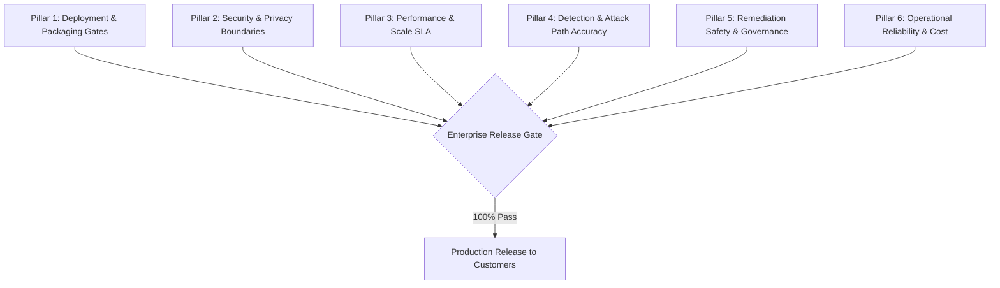

# REVISED ENTERPRISE ACCEPTANCE CRITERIA
**Document ID:** `AEGIS-ARCH-028`  
**Domain:** Engineering Acceptance Gates, Release Quality Standards, Verification Checklists  
**Status:** Architecture Blueprint / Phase 0.5 Deliverable  

---

## 1. Executive Summary & Quality Standard

Before any customer organization deploys AEGIS into their production AWS account, the release must satisfy verifiable acceptance criteria across 6 architectural pillars.

---

## 2. Six Enterprise Acceptance Pillars

### Pillar 1: Deployment & Packaging Gates
- [ ] CloudFormation template (`aegis_customer_deployable_stack.yml`) deploys in $< 8\text{ minutes}$ with zero manual intervention.
- [ ] Stack provisions strictly in-account resources with scoped IAM execution roles (`SecurityAudit`, `ViewOnlyAccess`).
- [ ] Zero public S3 bucket or unencrypted database created.

### Pillar 2: Security & Privacy Boundaries
- [ ] Foundation model inference routes strictly via AWS PrivateLink to Bedrock; zero external SaaS proxy.
- [ ] Client-side PII and secret redaction filter achieves 100% masking across AWS access keys, tokens, and connection strings.
- [ ] Forensic evidence bucket enforces S3 Object Lock in Governance Mode with customer KMS CMK encryption.

### Pillar 3: Performance & Scale SLA
- [ ] Full infrastructure harvest across 500 resources completes in $< 45\text{ seconds}$.
- [ ] NetworkX graph construction and BFS attack path trace completes in $< 2.0\text{ seconds}$.
- [ ] Pull request IaC gatekeeper evaluation finishes within the **45-second SLA**.

### Pillar 4: Detection & Posture Accuracy
- [ ] Context Completeness Gate enforces task-specific required evidence (IAM, Network, Container, Forensics), rejecting incomplete discoveries with actionable missing requirement reports.
- [ ] Multi-layer network reachability engine distinguishes between topological graph adjacency and verified packet flow (Route Tables, IGW, SGs, NACLs).
- [ ] 100% of planted vulnerabilities in the disposable test lab are detected with zero false negatives.

### Pillar 5: Remediation Safety & Governance
- [ ] Mode 1 (Advisory) generates syntactically valid Terraform diffs with zero cloud mutation.
- [ ] Mode 2 (Human-Approved) enforces cryptographic sign-off by `Remediation Approver` role before executing AWS API mutations.
- [ ] Production lockout rule immutably prevents Mode 3 auto-remediation on resources tagged `Environment=Production`.
- [ ] Automated compensation action runbook reverses failed mutations during health check timeouts.

### Pillar 6: Operational Reliability & FinOps
- [ ] Customer idle infrastructure footprint verified at $< \$0.50 / \text{month}$.
- [ ] Multi-layer test lab cost controls (4-hour TTL auto-shutdown Lambda, $5.00 CloudWatch alarm) guarantee test runs complete for $< \$0.25$.
- [ ] Zero unhandled Promise rejections or memory leaks across all 11 web console workspaces.
