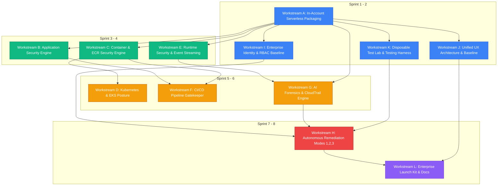

# REVISED WORKSTREAM DEPENDENCIES & CRITICAL PATH
**Document ID:** `AEGIS-ARCH-024`  
**Domain:** Engineering Dependencies, Critical Path Analysis, Parallel Workstreams  
**Status:** Architecture Blueprint / Phase 0.5 Deliverable  

---

## 1. Executive Summary & Structural Logic

A workstream dependency graph must reflect genuine technical prerequisites rather than arbitrary calendar sequencing. 

This specification maps the **true technical dependencies** across all 12 AEGIS workstreams, highlighting parallel execution paths, foundational gating requirements, and the critical path to product release.

---

## 2. Complete Technical Dependency Diagram

---

## 3. Critical Path & Gating Analysis

### 3.1 The Critical Path
The longest sequence of dependent engineering tasks required to achieve a production-ready enterprise release is:
$$\text{Critical Path: } \mathbf{A} \rightarrow \mathbf{I} \rightarrow \mathbf{E} \rightarrow \mathbf{G} \rightarrow \mathbf{H} \rightarrow \mathbf{L} \quad (\approx 10\text{ Weeks})$$

- **Workstream A (Packaging):** Must establish the in-account IAM execution boundary, DynamoDB tables, and S3 state bucket.
- **Workstream I (Identity & RBAC):** Must establish the `Remediation Approver` and `Security Analyst` roles before any remediation engine can be safely built.
- **Workstream E (Runtime Streaming):** Must establish EventBridge queueing to provide live alert telemetry.
- **Workstream G (AI Forensics):** Correlates CloudTrail events with graph state to compute blast radius.
- **Workstream H (Remediation):** Requires identity sign-off, blast radius computation, and test lab validation.
- **Workstream L (Launch):** Packages the verified system for enterprise customer deployment.

### 3.2 Parallelizable Engineering Tracks
1. **Workstream B (AppSec) & C (Containers):** Can proceed completely in parallel during Sprint 3 once Workstream A provides the S3 finding storage schemas.
2. **Workstream J (Unified UX):** Starts in Sprint 2 and evolves incrementally across all sprints, integrating each workspace as its backend APIs are delivered.
3. **Workstream F (CI/CD Gatekeeper):** Can be engineered in parallel with Workstream D (Kubernetes) during Sprint 5.
