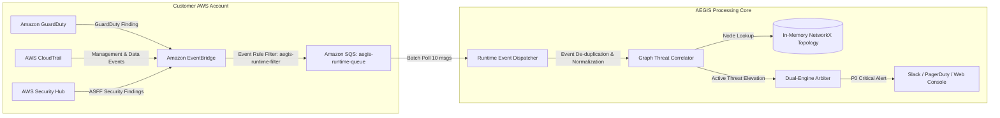

# RUNTIME SECURITY & THREAT CORRELATION ARCHITECTURE
**Document ID:** `AEGIS-ARCH-010`  
**Domain:** Cloud Runtime Threat Detection, Amazon GuardDuty, AWS Security Hub, EventBridge Streaming  
**Author:** Principal Enterprise Cloud Security Architect  
**Status:** Architecture Blueprint / Discovery Phase  

---

## 1. Executive Summary & Core Objective

Static infrastructure posture management (CSPM) reveals what *could* happen based on misconfigurations and attack paths. Runtime threat detection reveals what *is currently* happening based on behavioral anomalies, credential misuse, network telemetry, and active exploit attempts.

AEGIS bridges static posture with live runtime detection by creating a **Unified Threat Correlation Engine**. Instead of forcing customers to deploy heavy, fragile eBPF or kernel-level host agents across hundreds of EC2 instances and EKS nodes, AEGIS adopts an **agentless, cloud-native runtime ingestion model** powered by Amazon GuardDuty, AWS Security Hub (ASFF), AWS CloudTrail, and Amazon EventBridge. 

By mapping real-time runtime events onto the pre-computed NetworkX infrastructure graph, AEGIS immediately correlates an anomalous event (e.g. an API call from a Tor exit node) with static vulnerabilities (e.g. an overprivileged IAM role), dynamically escalating static findings to **Active Compromise (P0)** with exact blast radius and containment playbooks.

---

## 2. Ingestion Architecture: Cloud-Native Streaming vs Host Agents

### 2.1 The Host-Agent vs Agentless Architectural Trade-Off

| Vector | In-Host Agent (Falco / Osquery) | Cloud-Native Agentless (GuardDuty / CloudTrail / EventBridge) | AEGIS Decision |
| :--- | :--- | :--- | :--- |
| **Customer Friction** | High (Requires kernel modules, AMI baking, DaemonSets, daemon maintenance) | Zero (API-driven, managed by AWS, operates out of the box) | **Adopt Agentless Primary** |
| **Blast Radius / Risk** | Medium (Agent crash can impact production workloads) | Absolute Zero (Out-of-band monitoring) | **Agentless** |
| **Coverage Scope** | Host OS & Linux syscalls only; blind to AWS control plane API misuse | 100% AWS Control Plane, VPC Flow Logs, DNS logs, S3 data events, EKS audit logs | **Agentless** |
| **Cost** | Dedicated vCPU/RAM overhead on every EC2/EKS instance | Pay-per-event / managed AWS pricing (often covered by AWS enterprise agreements) | **Agentless** |
| **Latency** | Sub-second (syscall level) | GuardDuty (approx 5-15 min latency for complex ML; EventBridge sub-second for CloudTrail) | **Hybrid Ingestion** |

**Conclusion (ADR-003):** AEGIS implements an agentless runtime architecture as its default Tier 1 engine, with optional webhook endpoints for customers already running Falco or Sysdig.

---

## 3. Real-Time Streaming Pipeline



### 3.1 EventBridge Rule Configuration
The AEGIS deployment CloudFormation template provisions an EventBridge rule that filters security-relevant events:
```yaml
# deploy/aws/aegis_runtime_eventbridge.yml
Resources:
  AegisRuntimeSecurityRule:
    Type: AWS::Events::Rule
    Properties:
      Name: aegis-security-runtime-stream
      Description: Captures GuardDuty findings and high-risk CloudTrail events for AEGIS
      EventPattern:
        source:
          - "aws.guardduty"
          - "aws.securityhub"
        detail-type:
          - "GuardDuty Finding"
          - "Security Hub Findings - Imported"
      Targets:
        - Arn: !GetAtt AegisRuntimeEventQueue.Arn
          Id: "AegisSQSTarget"
```

---

## 4. GuardDuty Finding Taxonomy & Mapping

AEGIS ingests and maps all major GuardDuty finding classes directly into graph nodes:

1. **IAM & Credential Exfiltration**:
   - `UnauthorizedAccess:IAMUser/InstanceCredentialExfiltration.OutsideAWS`: Temporary EC2 instance profile credentials used from an external IP address.
   - `PrivilegeEscalation:IAMUser/AdministrativePermissions`: IAM entity modified its own permissions to gain admin rights.
   - `Stealth:IAMUser/CloudTrailLoggingDisabled`: Attacker attempting to evade detection.
2. **Compute & Container Attacks**:
   - `CryptoCurrency:EC2/BitcoinTool.B!DNS`: Instance querying known crypto-mining pools.
   - `Execution:EC2/SuspiciousCommand`: Suspicious reverse-shell or payload executed.
   - `PrivilegeEscalation:Kubernetes/PrivilegedContainer`: Container launched with root breakout privileges.
3. **Storage & Data Theft**:
   - `Exfiltration:S3/AnomalousVolume`: Mass download from sensitive S3 buckets from unrecognized location.
   - `Discovery:S3/MaliciousIPCaller`: Reconnaissance against private S3 buckets.

---

## 5. Dynamic Severity Elevation Logic

A standalone GuardDuty finding is often noisy. A static CSPM misconfiguration is often deprioritized as "theoretical". When AEGIS unites them, threat confidence reaches 99.9%.

$$\text{Threat Priority Score} = \text{Base Severity}(\text{Finding}) \times (1 + \text{Centrality}(\text{Graph Node})) \times \text{Exposure Multiplier}$$

### Elevation Rules:
- **Rule 1 (Exposed Node Active Exploit)**: If an EC2 instance or Pod has a known vulnerability or public ingress AND GuardDuty fires `UnauthorizedAccess:EC2/SSHBruteForce` or `Execution:EC2/MaliciousFile` $\rightarrow$ Elevate to **P0 Critical Active Breach**.
- **Rule 2 (Credential Exfiltration on Attack Path)**: If an IAM Role on a pre-identified Critical Attack Path generates `InstanceCredentialExfiltration.OutsideAWS` $\rightarrow$ Elevate to **P0 Critical** and trigger immediate Emergency Containment SOP.
- **Rule 3 (Data Exfiltration from Crown Jewel)**: If an S3 bucket classified as Crown Jewel receives high-volume `GetObject` from an untrusted ASN $\rightarrow$ Trigger automated bucket isolation proposal.
